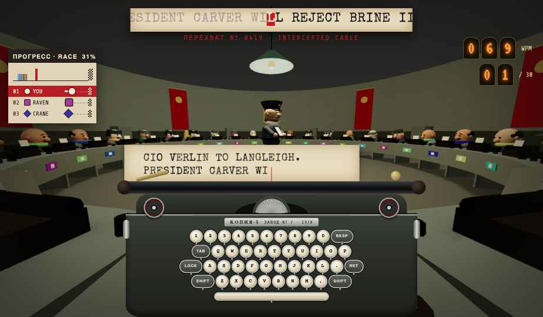
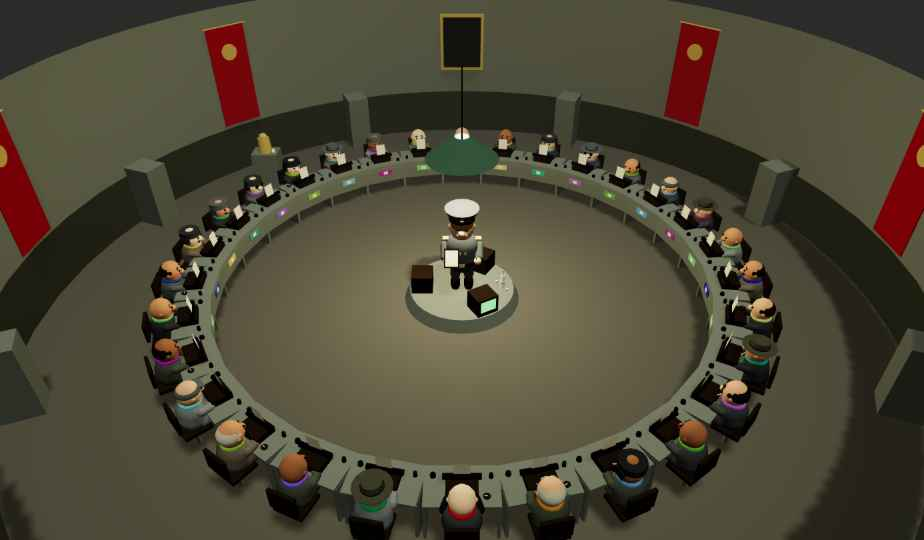
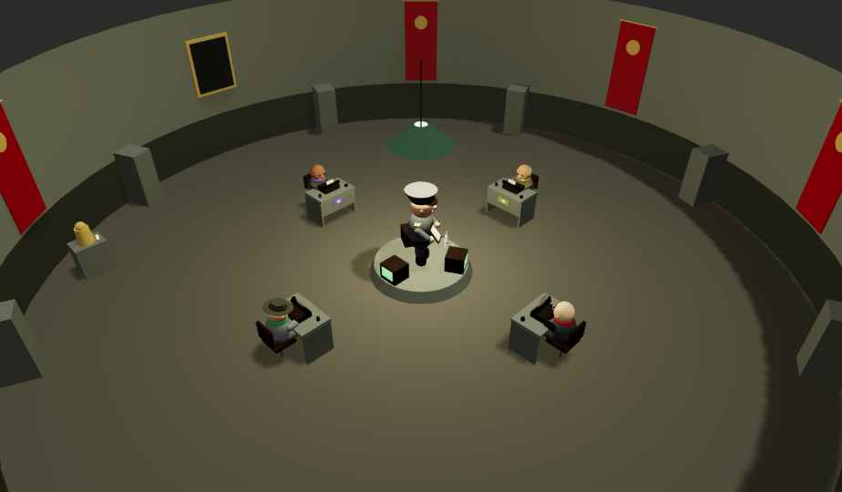
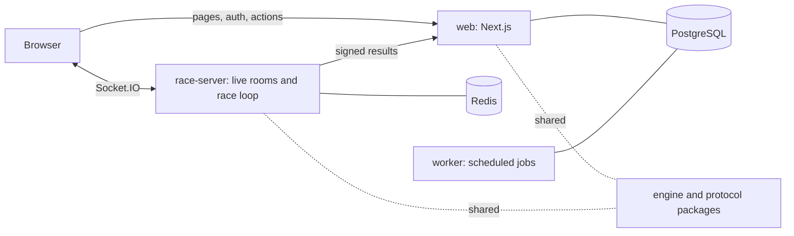

# Fifth Copy

**Play it: [fifthcopy.com](https://fifthcopy.com)**

Fifth Copy is a real-time typing race for the classroom, in English and French. Up to 30 players sit in a ring room of desks, all typing the same text as fast and as accurately as they can, and watch their rivals' positions change live. It is built for students aged 12 to 17 and their teacher, who hosts the room.

The setting is a toy-sized bureaucracy: big-headed clerks at typewriters under a single lamp, with a Major at the centre. It is meant to be funny and never grim.

## How it plays

- **Same text for everyone.** The host creates a private room (or you hop into a quick race), shares a code or link, and starts the race when everybody is seated.
- **Live positions.** You see your clerk's desk from a first-person view; the 3D ring shows who is ahead.
- **Catch-up Sabotage cards.** The further behind you are, the more help you get: add paperwork to the leader, trim your own text, or blur the players ahead for a few seconds. The leader never gets cards, and the host can switch them off.
- **Dawn report.** After the race: podium, full ranking, and a personal card with speed, accuracy and where you slipped.
- **Personnel file.** Every player, guests included, builds a profile with progress over time, a keyboard heatmap (including French accents) and personal bests.
- **Accounts or guests.** Play as a guest straight away, or sign in with a username, Discord or Google. A guest's history is kept when they create an account.
- **Made for school laptops.** The 3D room adapts to the device, and the race works fully on a plain paper view when 3D is not available.

## Screenshots

The 3D room, as rendered by the game.

| Your desk | The full ring (30 desks) | A small lobby (4 desks) |
|---|---|---|
|  |  |  |

## Architecture

Three processes share one pure race engine, so scores are identical wherever they are computed.

- **web** (repo root): routes, accounts, lobbies, texts, results and stats. The only writer of PostgreSQL.
- **race-server** (`services/race-server`): the authoritative race loop, bots and live room state in Redis. It has no database; finished races are sent to the web app over a signed internal API.
- **worker** (`src/worker`): scheduled jobs such as stats roll-ups and data purges.
- **`packages/engine`**: the pure race rules (scoring, bonuses, bots), used by both the web app and the race server.
- **`packages/protocol`**: the typed messages exchanged over the wire.

Hosted on Railway: web, race-server and worker, plus managed PostgreSQL and Redis.

### Documentation

| Topic | Where |
|---|---|
| Architecture: containers, flows, data, real-time protocol | [docs/architecture/ARCHITECTURE.md](docs/architecture/ARCHITECTURE.md) |
| Architecture decisions (ADRs) | [docs/adr/](docs/adr/) |
| Product specification | [docs/spec/fifth-copy-spec.md](docs/spec/fifth-copy-spec.md) |
| Design bible: look, motion, 3D, copy | [docs/design/bible/FIFTH_COPY_DESIGN_BIBLE.md](docs/design/bible/FIFTH_COPY_DESIGN_BIBLE.md) |
| Design tokens and components | [docs/design/](docs/design/) |
| Privacy | [docs/privacy/](docs/privacy/) |
| Contributing, commands and conventions | [AGENTS.md](AGENTS.md) |

Built with Next.js, Prisma, PostgreSQL, Socket.IO, Redis and three.js.
